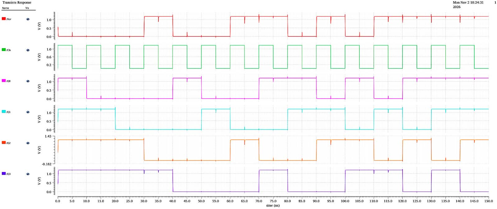

# 4-Bit LFSR — Timing, Power and Performance Analysis

> Waveform-based calculation and performance report for the 4-bit Linear Feedback Shift Register (LFSR). The report follows the organization of a transistor-level custom IC performance report: timing, propagation delay, RC/Elmore delay, power, PDP/EDP and performance summary. Only values supported by the supplied LFSR waveform are presented as measurements. Parameters requiring current waveforms or extracted parasitics are explicitly identified as pending measurement.

---

## 📌 Table of Contents

- [Project and Simulation Overview](#-project-and-simulation-overview)
- [Measured Waveform Results](#-measured-waveform-results)
- [Timing Performance Breakdown](#-timing-performance-breakdown-t_plh-t_phl-t_pd)
- [Clock-to-Q, Setup, Hold and Clock Timing](#-clock-to-q-setup-hold-and-clock-timing)
- [RC Parasitic and Elmore Delay Analysis](#-rc-parasitic-and-elmore-delay-analysis)
- [Power Analysis: Dynamic, Static and Average Power](#-power-analysis-dynamic-static-and-average-power)
- [PDP and EDP Analysis](#-pdp-and-edp-analysis)
- [Performance Summary](#-performance-summary)
- [Data Required for Complete Post-Layout Results](#-data-required-for-complete-post-layout-results)

---

## 🔬 Project and Simulation Overview

The project is a 4-bit Linear Feedback Shift Register (LFSR) implemented and simulated using Cadence. The supplied transient response displays the XOR feedback signal, clock and four register outputs.

### Transient response waveform

**Signals displayed:**

| Signal | Description |
|---|---|
| `/Xor` | XOR feedback signal |
| `/CLK` | Clock input |
| `/Q0` | LFSR register output bit 0 |
| `/Q1` | LFSR register output bit 1 |
| `/Q2` | LFSR register output bit 2 |
| `/Q3` | LFSR register output bit 3 |

The horizontal time axis covers approximately 0 ns to 150 ns. The clock waveform shows a repeating period of approximately 10 ns.

---

## 📊 Measured Waveform Results

The following values are read from the time axis and clock waveform in the supplied graph.

| Parameter | Symbol | Waveform result | Calculation |
|---|---:|---:|---|
| Simulation start time | (t_{start}) | 0 ns | Graph origin |
| Simulation stop time | (t_{stop}) | 150 ns | Graph end |
| Observation interval | (T_{obs}) | 150 ns | (150 - 0) ns |
| Clock period | (T_{clk}) | **10 ns** | Rising edge to next rising edge |
| Clock frequency | (f_{clk}) | **100 MHz** | (1/(10\,ns)) |
| Clock HIGH time | (T_H) | **5 ns** | Read from CLK high interval |
| Clock LOW time | (T_L) | **5 ns** | Read from CLK low interval |
| Clock duty cycle | (D) | **50%** | ((5/10)\times100) |
| Clock cycles in displayed interval | (N) | **Approximately 15** | (150/10) |

### Clock frequency calculation

[
f_{clk}=\frac{1}{T_{clk}}
=\frac{1}{10\times10^{-9}}
=100\times10^6\;Hz
=\boxed{100\;MHz}
]

### Duty-cycle calculation

[
D=\frac{T_H}{T_{clk}}\times100
=\frac{5}{10}\times100
=\boxed{50\%}
]

### Clock waveform interpretation

- The clock has approximately equal HIGH and LOW intervals.
- One complete clock cycle takes approximately 10 ns.
- Approximately 15 clock cycles are visible over the 150 ns observation interval.
- The Q0–Q3 outputs change state in response to clock events, consistent with sequential LFSR operation.

**Voltage note:** The plotted logic-high plateaus appear to be around 1.2 V by visual inspection. This is only an approximate graph reading; the screenshot does not specify the supply rail or provide a precise DC supply measurement. Do not treat this visual estimate as a confirmed (V_{DD}).

---

## ⏱️ Timing Performance Breakdown ((t_{PLH}), (t_{PHL}), (t_{pd}))

Propagation delay is measured between the 50% voltage crossings of the triggering input and the responding output.

For a measured voltage swing from (V_{OL}) to (V_{OH}):

[
V_{50\%}=V_{OL}+0.5(V_{OH}-V_{OL})
]

### Timing equations

**Low-to-high propagation delay:**

[
t_{PLH}=t_{output,rise(50\%)}-t_{input(50\%)}
]

**High-to-low propagation delay:**

[
t_{PHL}=t_{output,fall(50\%)}-t_{input(50\%)}
]

**Average propagation delay:**

[
t_{pd(avg)}=\frac{t_{PLH}+t_{PHL}}{2}
]

### Timing results supported by the supplied graph

| Timing parameter | Result from supplied waveform | Measurement status |
|---|---:|---|
| (t_{PLH}) of XOR gate | Not numerically determined | XOR input waveform is not displayed |
| (t_{PHL}) of XOR gate | Not numerically determined | XOR input waveform is not displayed |
| Average XOR propagation delay | Not numerically determined | Requires measured (t_{PLH}) and (t_{PHL}) |
| Clock-to-Q0 delay | Not precisely resolved | Requires precise 50% edge measurements |
| Clock-to-Q1 delay | Not precisely resolved | Requires precise 50% edge measurements |
| Clock-to-Q2 delay | Not precisely resolved | Requires precise 50% edge measurements |
| Clock-to-Q3 delay | Not precisely resolved | Requires precise 50% edge measurements |
| Clock period | **10 ns (approx.)** | Read from graph |
| Clock frequency | **100 MHz (approx.)** | Calculated from period |

**Important measurement limitation:** The screenshot displays the XOR output but not both XOR input signals. Therefore, XOR (t_{PLH}) and (t_{PHL}) cannot be calculated from this image. The clock period is not propagation delay. The visually aligned clock and output edges do not establish zero clock-to-Q delay.

### Cadence measurement procedure

1. Open the transient simulation in Cadence ViVA.
2. Display the XOR input signals, XOR output and the clock.
3. Set the threshold to 50% of the measured voltage swing.
4. Measure the input and output crossing times for each transition.
5. Calculate (t_{PLH}) and (t_{PHL}) separately.
6. Repeat for Q0–Q3 to obtain clock-to-Q delay.
7. Record the minimum, maximum and average values across valid transitions.

---

## 🕒 Clock-to-Q, Setup, Hold and Clock Timing

For a sequential circuit, the register timing parameters are important for reliable operation.

| Timing parameter | Symbol | Result from supplied graph | Required measurement |
|---|---|---|---|
| Clock-to-Q delay | (t_{CQ}) | Not precisely determined | Clock and Q 50% crossings |
| Setup time | (t_{setup}) | Not available | D-input stability before active clock edge |
| Hold time | (t_{hold}) | Not available | D-input stability after active clock edge |
| Clock skew | (t_{skew}) | Not available | Clock arrival at multiple register locations |
| Clock rise time | (t_r) | Not measured | 10%–90% clock transition |
| Clock fall time | (t_f) | Not measured | 90%–10% clock transition |
| Clock period | (T_{clk}) | **10 ns (approx.)** | Clock waveform |
| Clock frequency | (f_{clk}) | **100 MHz (approx.)** | (1/T_{clk}) |

The displayed waveform does not include the internal D-input waveforms or multiple clock locations. Therefore, setup time, hold time and clock skew must not be assigned numerical values from this plot.

---

## 📐 RC Parasitic and Elmore Delay Analysis

Post-layout interconnect parasitics influence propagation delay and power. Actual resistance and capacitance values must be extracted from the layout using the technology-specific Cadence extraction flow.

### RC equations

For a uniform rectangular interconnect:

[
R=\rho\frac{L}{W\times T}
]

Where:

- (
ho) = conductor resistivity
- (L) = interconnect length
- (W) = interconnect width
- (T) = metal thickness

Approximate parallel-plate capacitance:

[
C=\epsilon_0\epsilon_r\frac{A}{d}
]

Total parasitic capacitance:

[
C_{total}=C_{ground}+C_{coupling}
]

### RC performance table

| Parameter | Project result | Status |
|---|---:|---|
| Interconnect resistance (R) | Not available | Requires extracted layout |
| Ground capacitance (C_{ground}) | Not available | Requires extracted layout |
| Coupling capacitance (C_{coupling}) | Not available | Requires extracted layout |
| Total parasitic capacitance (C_{total}) | Not available | Requires extracted layout |
| Effective output resistance (R_{eff}) | Not available | Requires extracted RC network |
| Effective load capacitance (C_L) | Not available | Requires extracted RC network |

### Elmore delay calculation

For an RC tree:

[
t_{Elmore}=\sum_i R_i C_{downstream,i}
]

For a two-section RC ladder:

[
t_{Elmore}=R_1(C_1+C_2)+R_2C_2
]

For a simple dominant-pole approximation:

[
t_{50\%}\approx0.69\,t_{Elmore}
]

| Elmore parameter | Project result |
|---|---:|
| (R_1, R_2) | Requires extracted RC values |
| (C_1, C_2) | Requires extracted RC values |
| Elmore time constant | Not numerically determined |
| Approximate 50% RC delay | Not numerically determined |

The voltage waveform alone does not contain the distributed interconnect resistance or capacitance required for Elmore delay.

---

## ⚡ Power Analysis: Dynamic, Static and Average Power

The supplied graph displays voltage signals only. It does not show the supply-current waveform. Hence numerical power cannot be calculated reliably from this screenshot alone.

### 1. Dynamic power

Dynamic power is consumed when circuit capacitances charge and discharge during switching.

[
P_{dynamic}=\alpha C_{sw}V_{DD}^{2}f
]

Where:

- (alpha) = switching activity factor
- (C_{sw}) = effective switched capacitance
- (V_{DD}) = supply voltage
- (f) = operating frequency

The graph-based operating frequency is approximately 100 MHz. The other required quantities are not provided by the screenshot.

| Dynamic power parameter | Value |
|---|---:|
| Operating frequency | **100 MHz (approx.)** |
| Supply voltage (V_{DD}) | Not confirmed |
| Switching activity (alpha) | Not measured |
| Switched capacitance (C_{sw}) | Not available |
| Dynamic power (P_{dynamic}) | Requires current or capacitance data |

### 2. Static / leakage power

Static power is the power consumed due to leakage current when the circuit is not switching.

[
P_{static}=V_{DD}\times I_{leakage}
]

| Static power parameter | Value |
|---|---:|
| Supply voltage (V_{DD}) | Not confirmed |
| Leakage current (I_{leakage}) | Not available |
| Static power (P_{static}) | Not numerically determined |

### 3. Average power

Average power is obtained by integrating instantaneous supply power over the selected measurement interval.

[
P_{avg}=\frac{1}{T}\int_0^T V_{DD}(t)I_{supply}(t)\,dt
]

For a constant supply voltage:

[
P_{avg}=V_{DD}\times I_{avg}
]

| Average power parameter | Value |
|---|---:|
| Measurement interval shown | **150 ns** |
| Average supply current | Not available |
| Average power | Not numerically determined |

If average power is measured directly from the total supply current during switching, it already includes leakage power. Do not add static power a second time.

---

## 📉 PDP and EDP Analysis

Power-delay product and energy-delay product are useful figures of merit for comparing circuit performance.

### 1. Power-delay product (PDP)

[
PDP=P_{avg}\times t_{pd}
]

Unit:

[
W\times s=J
]

### 2. Energy-delay product (EDP)

[
EDP=PDP\times t_{pd}
=P_{avg}\times t_{pd}^{2}
]

Unit:

[
J\times s
]

| Performance metric | Project result |
|---|---:|
| Average power (P_{avg}) | Requires supply-current data |
| Average propagation delay (t_{pd}) | Requires 50% crossing measurements |
| Power-delay product (PDP) | Cannot yet be calculated |
| Energy-delay product (EDP) | Cannot yet be calculated |

No numerical PDP or EDP is claimed because the required measured power and propagation delay values are not available in the supplied graph.

---

## 📊 Performance Summary

| No. | Performance parameter | Value from LFSR waveform |
|---:|---|---:|
| 1 | Circuit | 4-bit LFSR |
| 2 | Simulation interval | 0–150 ns |
| 3 | Clock period | **10 ns (approx.)** |
| 4 | Clock frequency | **100 MHz (approx.)** |
| 5 | Clock HIGH time | **5 ns (approx.)** |
| 6 | Clock LOW time | **5 ns (approx.)** |
| 7 | Duty cycle | **50% (approx.)** |
| 8 | Visible clock cycles | **Approximately 15** |
| 9 | XOR (t_{PLH}) | Requires XOR input waveform |
| 10 | XOR (t_{PHL}) | Requires XOR input waveform |
| 11 | Average propagation delay | Requires threshold measurements |
| 12 | Clock-to-Q delay | Requires precise threshold measurements |
| 13 | Setup time | Requires D-input waveform |
| 14 | Hold time | Requires D-input waveform |
| 15 | Clock skew | Requires multiple clock locations |
| 16 | Effective resistance | Requires extracted RC data |
| 17 | Effective capacitance | Requires extracted RC data |
| 18 | Elmore delay | Requires extracted RC data |
| 19 | Dynamic power | Requires switching power data |
| 20 | Static power | Requires leakage current |
| 21 | Average power | Requires supply-current waveform |
| 22 | PDP | Requires measured power and delay |
| 23 | EDP | Requires measured power and delay |

---

## 🧪 Data Required for Complete Post-Layout Results

To replace the pending entries with actual measured numerical values, export the following from Cadence:

1. **Transient waveform CSV/PSF:** CLK, XOR input signals, XOR output, Q0, Q1, Q2 and Q3.
2. **Power data:** VDD supply voltage and supply-current waveform over the selected simulation interval.
3. **Leakage data:** Stable-state supply current for static power.
4. **RC extraction:** Quantus/QRC or Assura RCX extracted DSPF/SPEF report.
5. **Timing data:** Input-to-output 50% threshold crossings and sequential timing constraints.

### Cadence post-layout calculation flow

1. Complete the layout and run DRC.
2. Run LVS to verify schematic and layout consistency.
3. Perform parasitic extraction using the appropriate technology setup.
4. Back-annotate extracted parasitics into the post-layout simulation.
5. Run transient simulation and export voltage and supply-current waveforms.
6. Measure propagation delay, clock-to-Q, dynamic power, leakage power and average power.
7. Calculate PDP and EDP using the measured average power and propagation delay.

---

## ✅ Conclusion

The supplied Cadence transient waveform confirms the 4-bit LFSR clock operation over an approximately 150 ns interval. The clock period is approximately 10 ns, corresponding to a frequency of 100 MHz, with approximately 5 ns HIGH time, 5 ns LOW time and 50% duty cycle.

The waveform also displays the XOR feedback and four register outputs. Exact propagation delay, clock-to-Q, setup/hold time, RC parasitics, Elmore delay, dynamic power, static power, average power, PDP and EDP require additional transient measurements or extracted layout data. These values are not replaced with measurements from the unrelated CLA reference project.

---

**Project:** 4-Bit Linear Feedback Shift Register (LFSR)  
**Author:** Rathla Deepika  
**EDA Tool:** Cadence Virtuoso  
**Repository:** [Deepika8520/4_LFSR](https://github.com/Deepika8520/4_LFSR)

**Reference format:** [8-Bit Carry Look-Ahead Adder — Timing and Power Analysis](https://github.com/bollaraputhanisha-pixel/8-Bit-Carry-Look-Ahead-Adder-implementation-in-Cadence-90nm/blob/main/README.md#-16-bit-cla-extension)
