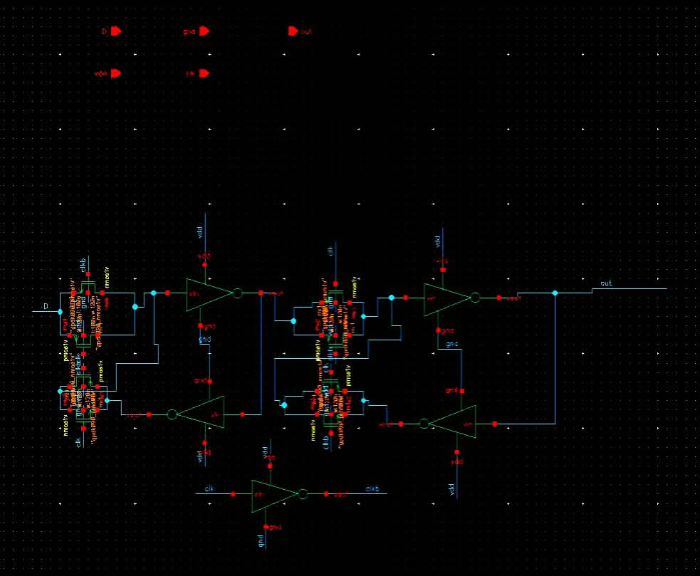
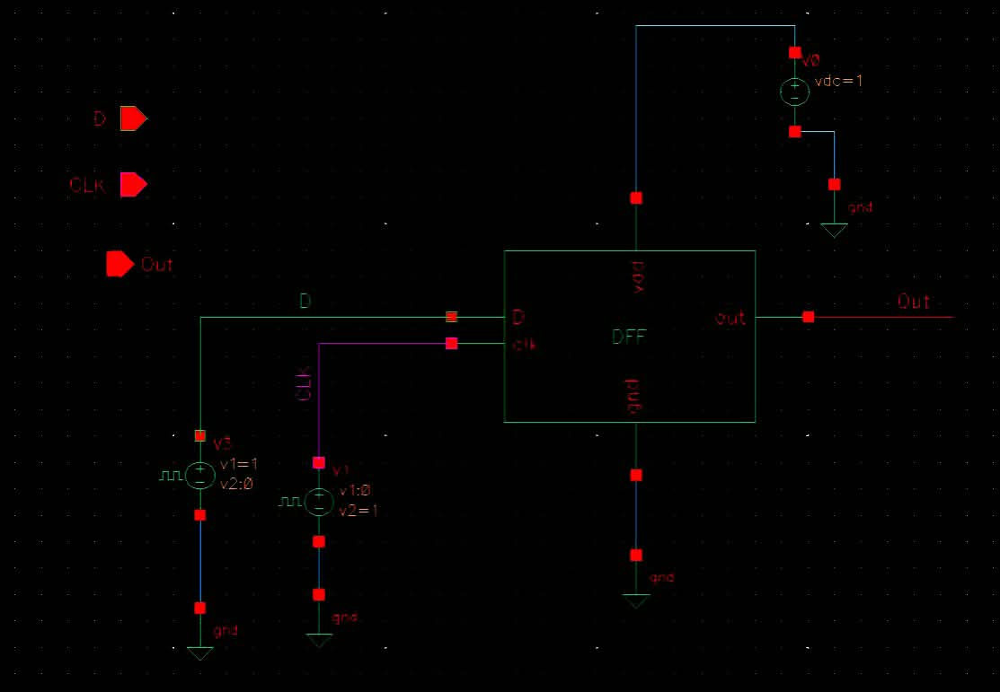
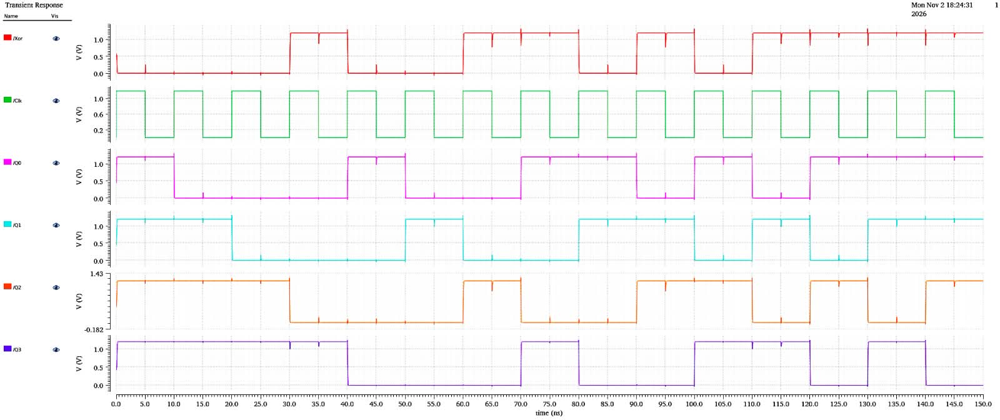

# 4-Bit Linear Feedback Shift Register (LFSR) Design

## Project Overview

This project focuses on the design and implementation of a **4-Bit Linear Feedback Shift Register (LFSR)** using digital IC design techniques.

An LFSR is a sequential digital circuit that generates pseudo-random binary sequences using shift registers and XOR-based feedback logic.

The design consists of four D Flip-Flops and XOR-based feedback logic to generate the next-state input and shift the stored data on every active clock edge.

## Objectives

- Understand the working principle of a Linear Feedback Shift Register.
- Design a 4-bit shift register using D Flip-Flops.
- Implement XOR-based feedback logic.
- Design and implement the circuit schematic and physical layout.
- Verify functionality using simulation waveforms.
- Evaluate timing, power and interconnect parasitics.

## Circuit Architecture

The 4-Bit LFSR consists of:

- Four D Flip-Flops.
- XOR feedback logic.
- Clock input.
- Reset or initialization mechanism.
- Four-bit output.

## Working Principle

1. The circuit is initialized with a non-zero seed value.
2. The clock signal controls the shifting operation.
3. XOR logic generates the feedback bit.
4. The register shifts its stored bits on every active clock edge.
5. The feedback bit is inserted into the selected register stage.
6. This process repeats to generate a pseudo-random binary sequence.

## Design Implementation

The project includes the following circuit designs:

1. Inverter schematic and layout.
2. XOR gate schematic, symbol and layout.
3. D Flip-Flop schematic and testbench.
4. 4-Bit LFSR circuit design.
5. 4-Bit LFSR physical layout.
6. Simulation waveform analysis.

## Project Images

### 1. Inverter Design

### 2. XOR Gate Design

### 3. D Flip-Flop Design

### 4. 4-Bit LFSR

### 5. 4-Bit LFSR Layout

### 6. Simulation Results

---
## Final Results

### 4-Bit LFSR Design Verification

| S.No | Parameter | Expected Result |
|---|---|---|
| 1 | Design | 4-Bit Linear Feedback Shift Register |
| 2 | Number of Flip-Flops | 4 |
| 3 | Feedback Logic | XOR Gate |
| 4 | Clock Signal | Applied |
| 5 | Layout Design | Completed |
| 6 | DRC Verification | PASS |
| 7 | DRC Errors | 0 |
| 8 | LVS Verification | PASS |
| 9 | Netlist Comparison | Matched |
| 10 | Final Status | Successful |

### DRC Results

- Design Rule Check (DRC) was performed on the 4-bit LFSR layout.
- Metal width and spacing rules were checked.
- Via and contact design rules were verified.
- No DRC violations were observed.

**DRC Status: PASS**

### LVS Results

- Layout Versus Schematic (LVS) verification was performed.
- Extracted layout netlist was compared with the schematic netlist.
- Device connectivity was verified.
- The schematic and extracted netlists matched successfully.

**LVS Status: PASS**

### Final Outcome

The 4-bit LFSR schematic and physical layout were successfully designed using Cadence Virtuoso.

DRC verification confirmed that the layout satisfies the design rules, and LVS verification confirmed that the extracted layout netlist matches the reference schematic.

The design verification was completed successfully.

**Final Result: DRC PASS | LVS PASS**
