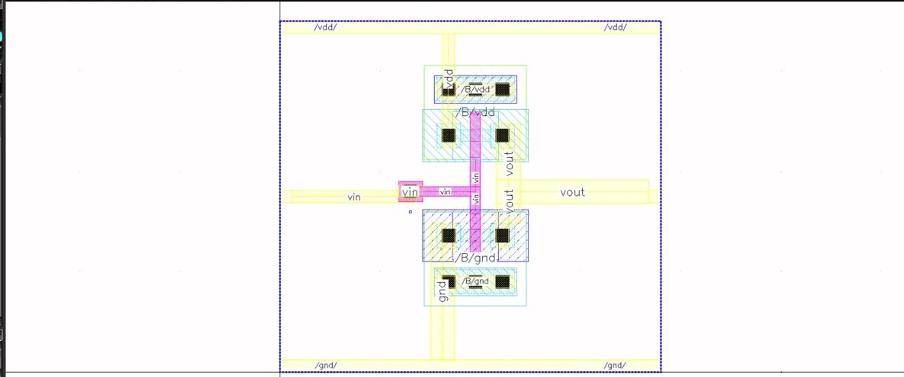
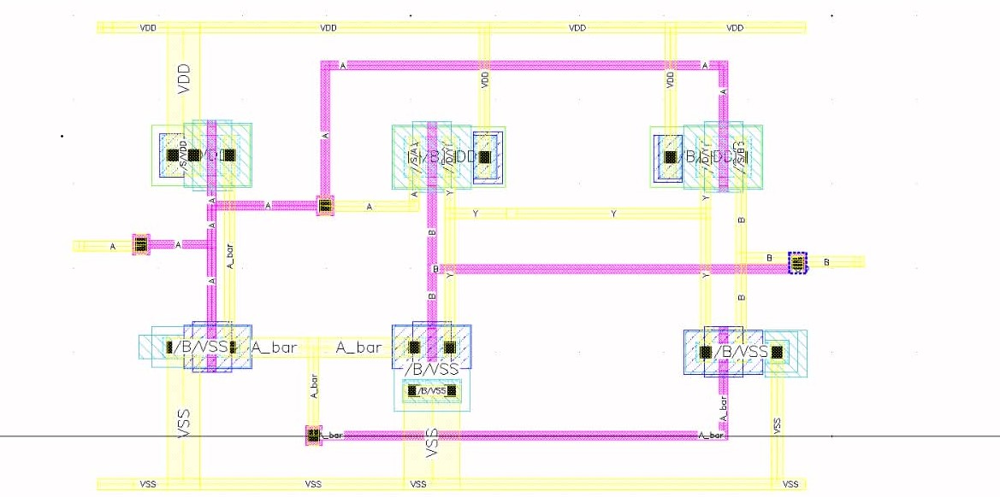
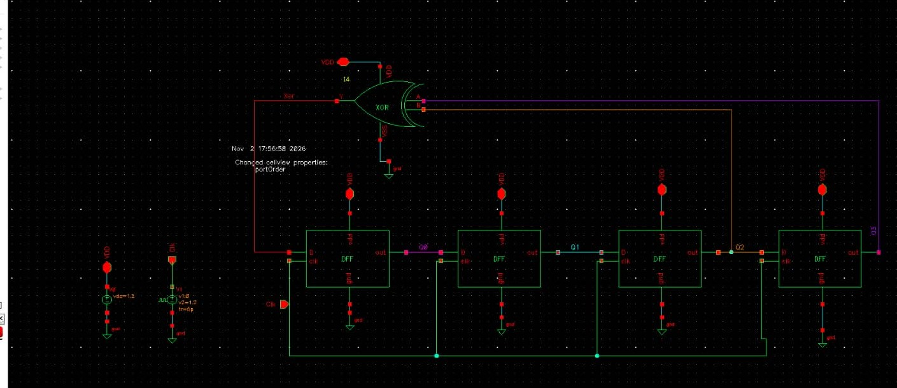
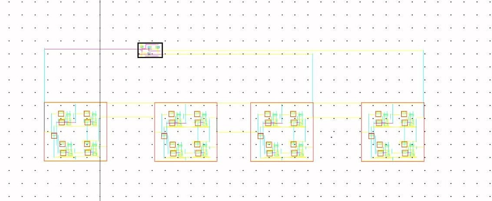

# 4-Bit Linear Feedback Shift Register (LFSR) Design

## Project Overview

This project focuses on the design and implementation of a **4-Bit Linear Feedback Shift Register (LFSR)** using digital IC design techniques.

An LFSR is a sequential digital circuit that generates pseudo-random binary sequences using shift registers and XOR-based feedback logic.

The design consists of four D Flip-Flops and XOR feedback logic to generate the next-state input and shift the stored data on every active clock edge.

## Objectives

- To understand the working principle of a Linear Feedback Shift Register.
- To design a 4-bit shift register using D Flip-Flops.
- To implement XOR-based feedback logic.
- To design and implement the circuit schematic.
- To perform circuit simulation and verify output waveforms.
- To design the physical layout of the circuit.

## Circuit Architecture

The 4-Bit LFSR consists of:

- Four D Flip-Flops.
- XOR feedback logic.
- Clock input.
- Reset or initialization mechanism.
- Four-bit output.

## Working Principle

1. The circuit is initialized with a non-zero seed value.
2. The clock signal controls the shifting operation.
3. XOR logic generates the feedback bit.
4. The register shifts its stored bits on every active clock edge.
5. The feedback bit is inserted into the selected register stage.
6. This process repeats to generate a pseudo-random binary sequence.

## Design Implementation

The project includes the following circuit designs:

1. Inverter schematic and layout.
2. XOR gate schematic, symbol and layout.
3. D Flip-Flop schematic and testbench.
4. 4-Bit LFSR circuit design.
5. 4-Bit LFSR physical layout.
6. Simulation waveform analysis.

## Project Images

### 1. Inverter Design

### 2. XOR Gate Design

### 3. D Flip-Flop Design

### 4. 4-Bit LFSR 

### 5. 4-Bit LFSR Layout

### 6. Simulation Results

## Tools and Technologies

- Cadence Virtuoso
- CMOS Transistor-Level Design
- Digital IC Design
- D Flip-Flop
- XOR Logic
- Schematic Design
- Physical Layout Design
- Circuit Simulation

## Applications

- Pseudo-Random Number Generation
- Built-In Self-Test (BIST)
- Error Detection
- CRC Generation
- Data Scrambling
- Digital System Testing

## Conclusion

The 4-Bit LFSR project demonstrates the design and implementation of a sequential digital circuit using D Flip-Flops and XOR feedback logic.

Through this project, I gained practical knowledge of sequential circuit design, transistor-level schematic implementation, physical layout design and simulation waveform analysis.

## Author

**Rathla Deepika**

VLSI and Microelectronics

GitHub: [Deepika8520](https://github.com/Deepika8520)

## Project Repository

[4-Bit LFSR – GitHub Repository](https://github.com/Deepika8520/4_LFSR)

