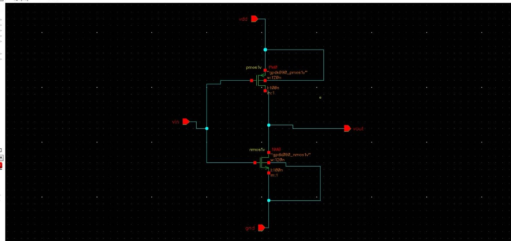
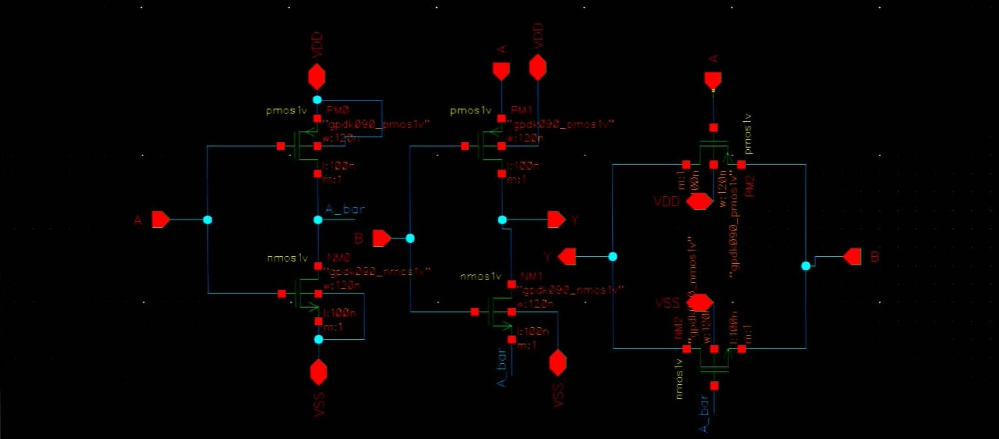

# 4-Bit Linear Feedback Shift Register (LFSR) Design

## Project Overview

This project focuses on the design and implementation of a **4-Bit Linear Feedback Shift Register (LFSR)** using digital IC design techniques.

An LFSR is a sequential digital circuit that generates pseudo-random binary sequences using shift registers and XOR-based feedback logic.

The design consists of four D Flip-Flops and XOR-based feedback logic to generate the next-state input and shift the stored data on every active clock edge.

## Objectives

- Understand the working principle of a Linear Feedback Shift Register.
- Design a 4-bit shift register using D Flip-Flops.
- Implement XOR-based feedback logic.
- Design and implement the circuit schematic and physical layout.
- Verify functionality using simulation waveforms.
- Evaluate timing, power and interconnect parasitics.

## Circuit Architecture

The 4-Bit LFSR consists of:

- Four D Flip-Flops.
- XOR feedback logic.
- Clock input.
- Reset or initialization mechanism.
- Four-bit output.

## Working Principle

1. The circuit is initialized with a non-zero seed value.
2. The clock signal controls the shifting operation.
3. XOR logic generates the feedback bit.
4. The register shifts its stored bits on every active clock edge.
5. The feedback bit is inserted into the selected register stage.
6. This process repeats to generate a pseudo-random binary sequence.

## Design Implementation

The project includes the following circuit designs:

1. Inverter schematic and layout.
2. XOR gate schematic, symbol and layout.
3. D Flip-Flop schematic and testbench.
4. 4-Bit LFSR circuit design.
5. 4-Bit LFSR physical layout.
6. Simulation waveform analysis.

## Project Images

### 1. Inverter Design




### 2. XOR Gate Design




### 3. D Flip-Flop Design


### 4. 4-Bit LFSR


### 5. 4-Bit LFSR Layout


### 6. Simulation Results


---

# Timing Analysis

Timing analysis is used to evaluate how quickly the LFSR responds to input and clock transitions. Measure delays from transient simulation waveforms using consistent input/output threshold levels, normally 50% of the corresponding signal swing.

## Propagation Delay (tPHL and tPLH)

- **tPHL (high-to-low propagation delay):** Time between the input transition crossing its 50% point and the output transition crossing its 50% point when the output changes from HIGH to LOW.
- **tPLH (low-to-high propagation delay):** Time between the input transition crossing its 50% point and the output transition crossing its 50% point when the output changes from LOW to HIGH.

For a measured input/output pair:

```text
tPHL = t(output falling at 50%) - t(input triggering at 50%)
tPLH = t(output rising at 50%)  - t(input triggering at 50%)
```

Average propagation delay:

```text
tp(avg) = (tPHL + tPLH) / 2
```

For a sequential LFSR, characterize the relevant combinational paths (for example, XOR input-to-output and register-to-register paths) separately. For a register-to-register path, also account for clock-to-Q, setup time and interconnect delay. Do not treat the clock-to-Q delay as an ordinary combinational input-to-output delay.

| Timing parameter | Value from supplied waveform |
|---|---:|
| tPHL | Not measurable from the plotted waveform |
| tPLH | Not measurable from the plotted waveform |
| Average propagation delay | Cannot be calculated without tPHL and tPLH |
| Clock-to-Q delay | Not numerically resolvable from the plotted waveform |
| Setup time | Not measurable; D-input timing is not shown |
| Critical path delay | Not determinable from the plotted waveform |
| Clock period | Approximately 10 ns |
| Clock frequency | Approximately 100 MHz |
| Clock high time | Approximately 5 ns |
| Clock low time | Approximately 5 ns |
| Clock duty cycle | Approximately 50% |

**Interpretation of the supplied transient plot:** The clock waveform shows an approximately 10 ns period (100 MHz), with approximately 5 ns high and 5 ns low intervals (50% duty cycle). The displayed plot does not provide sufficiently precise 50% input/output crossing timestamps to calculate tPHL or tPLH. It also does not show the D-input waveform needed for setup-time measurement or the internal path/parasitic data needed for critical-path delay. Therefore, those values are explicitly left unreported rather than guessed.

## RC Parasitic Extraction

Parasitic extraction estimates the resistance and capacitance of layout interconnects. Extracted parasitics affect signal delay, transition time, power and signal integrity.

### Interconnect resistance

For a uniform rectangular metal wire:

```text
R = rho x L / (W x T)
```

Where:
- rho = metal resistivity (ohm-meter)
- L = wire length (meter)
- W = wire width (meter)
- T = metal thickness (meter)

### Capacitance

A simplified parallel-plate estimate is:

```text
C = epsilon0 x epsilonr x A / d
```

The actual interconnect capacitance includes ground and coupling components:

```text
Ctotal = Cground + Ccoupling
```

The equations above are first-order estimates only. For sign-off-quality values, use the process technology files and the foundry-qualified extraction tool; do not estimate actual parasitics from layout screenshots alone.

### Cadence extraction procedure

1. Complete and save the layout.
2. Run DRC and resolve all design-rule violations.
3. Run LVS and confirm that the layout matches the schematic.
4. Open the supported Quantus/QRC extraction flow for the PDK.
5. Select the correct technology file, extraction corner and RC options.
6. Run extraction and generate the parasitic view or DSPF/SPEF output supported by the simulation flow.
7. Configure post-layout simulation to use the extracted parasitics.
8. Compare pre-layout and post-layout delay and power results.

| Extracted parameter | Value |
|---|---:|
| Total interconnect resistance | To be filled from extraction report (ohm) |
| Ground capacitance | To be filled from extraction report (F) |
| Coupling capacitance | To be filled from extraction report (F) |
| Total parasitic capacitance | To be calculated/reported (F) |
| Extraction corner | To be specified |

## Elmore Delay

Elmore delay is a first-order delay estimate for an RC tree. For each resistor in the path from the source to the observation node, multiply that resistance by the total capacitance downstream of that resistor, then sum the products.

```text
tElmore = sum(Ri x Cdownstream,i)
```

For a two-section RC ladder:

```text
tElmore = R1(C1 + C2) + R2(C2)
```

The approximate 50%-level delay of a simple dominant-pole response is:

```text
t50 approximately 0.69 x tElmore
```

This 0.69 factor is an approximation, not a universal conversion for every RC network. Use the extracted RC topology and identify the actual source and destination nodes before calculating delay.

| Elmore calculation item | Value |
|---|---:|
| R1, R2, ... | From extracted RC network |
| C1, C2, ... | From extracted RC network |
| Elmore delay | To be calculated (s) |
| Approximate 50% delay, if applicable | To be calculated (s) |

## Power Analysis

Power is evaluated using supply voltage and current measured in simulation. Report the operating conditions (VDD, clock frequency, input activity, process/voltage/temperature corner and simulation interval) with every result.

### Dynamic power

Dynamic power is consumed when circuit capacitances charge and discharge during switching.

```text
Pdynamic = alpha x Csw x VDD^2 x f
```

Where:
- alpha = switching activity factor (define whether it counts transitions or charging events)
- Csw = effective switched capacitance (F)
- VDD = supply voltage (V)
- f = switching frequency (Hz)

For measured average supply current, the average power drawn from the supply is:

```text
Pavg = VDD x Iavg
```

For time-varying supply current over a simulation interval:

```text
Pavg = (1 / T) x integral from 0 to T of [VDD(t) x I(VDD,t)] dt
```

Use the simulator's current sign convention consistently; report power delivered by the supply as a positive consumption value.

### Static and leakage power

Static/leakage power is measured when the circuit is not switching and is in a stable logic state:

```text
Pleak = VDD x Ileak
```

For multiple supply rails:

```text
Pleak,total = sum(VDDk x Ileak,k)
```

Measure leakage for representative stable states because leakage can depend on the stored state and input conditions. Do not use a switching-period average current as leakage current.

### Average power

Average power over a defined simulation window is:

```text
Pavg = (1 / T) x integral from 0 to T of Psupply(t) dt
```

If dynamic and leakage components are separated consistently:

```text
Pavg approximately Pdynamic,avg + Pleak,avg
```

Avoid double counting: if Pavg is obtained directly from the total supply current during switching, it already includes both switching and leakage contributions. Do not add leakage again to that measured total.

| Power parameter | Measured value |
|---|---:|
| Supply voltage (VDD) | To be specified (V) |
| Clock frequency | To be specified (Hz) |
| Dynamic power | To be measured/calculated (W) |
| Static leakage current | To be measured (A) |
| Static leakage power | To be calculated (W) |
| Average supply current | To be measured (A) |
| Average power | To be measured/calculated (W) |

## Results Summary

Populate this table with values from schematic-level and extracted post-layout simulations. Keep units and simulation conditions consistent.

| Metric | Pre-layout | Post-layout |
|---|---:|---:|
| tPHL (ps) | TBD | TBD |
| tPLH (ps) | TBD | TBD |
| Average propagation delay (ps) | TBD | TBD |
| RC parasitics | N/A | From extraction |
| Elmore delay (ps) | Estimate, if available | From extracted RC |
| Dynamic power (W) | TBD | TBD |
| Static leakage power (W) | TBD | TBD |
| Average power (W) | TBD | TBD |

**Note:** TBD values are intentionally left blank until actual Cadence simulation and extraction reports are available. No measured performance values are claimed in this repository documentation.

## Tools and Technologies

- Cadence Virtuoso
- CMOS Transistor-Level Design
- Digital IC Design
- D Flip-Flop
- XOR Logic
- Schematic Design
- Physical Layout Design
- Transient Simulation
- DRC and LVS
- Quantus/QRC parasitic extraction (if available in the installed flow)

## Applications

- Pseudo-Random Number Generation
- Built-In Self-Test (BIST)
- Error Detection
- CRC Generation
- Data Scrambling
- Digital System Testing

## Conclusion

The 4-Bit LFSR project demonstrates the design and implementation of a sequential digital circuit using D Flip-Flops and XOR feedback logic. Timing analysis using tPHL and tPLH, RC parasitic extraction, Elmore delay estimation and power analysis provide a more complete view of circuit performance. Final numerical results must be populated from the actual Cadence simulations and extracted layout data.

## Author

**Rathla Deepika**

VLSI and Microelectronics

GitHub: [Deepika8520](https://github.com/Deepika8520)

## Project Repository

[4-Bit LFSR – GitHub Repository](https://github.com/Deepika8520/4_LFSR)

## Measurements extracted from the supplied transient waveform

The supplied transient waveform covers approximately 0 ns to 150 ns. The clock (CLK) repeats at approximately 10 ns intervals, with a high interval of approximately 5 ns and a low interval of approximately 5 ns.

| Waveform-derived parameter | Approximate value | Basis |
|---|---:|---|
| Clock period | 10 ns | Repeating CLK rising edges |
| Clock frequency | 100 MHz | 1 / 10 ns |
| Clock high time | 5 ns | CLK high interval |
| Clock low time | 5 ns | CLK low interval |
| Clock duty cycle | 50% | 5 ns / 10 ns × 100 |

These values are estimates read from the displayed waveform, not extracted from a simulator data file. The waveform is useful for checking the sequence and clock timing, but it does not by itself provide the numerical data needed for propagation delay, Elmore delay, parasitic RC, or average power.

### Timing values that still require simulation data

| Metric | Current status | Required measurement |
|---|---|---|
| tPHL | Not determined | Input and output 50% crossing times for a falling output transition |
| tPLH | Not determined | Input and output 50% crossing times for a rising output transition |
| Average propagation delay | Not determined | (tPHL + tPLH) / 2 |
| Clock-to-Q delay | Not determined | Active clock edge to corresponding Q output 50% crossing |
| Setup time | Not determined | Data transition relative to the active clock edge |
| Critical-path delay | Not determined | Timing analysis of the identified register-to-register path |
| Average power | Not determined | Time-averaged supply voltage × supply current over a stated interval |
| Extracted R and C | Not determined | Post-layout parasitic extraction report |
| Elmore delay | Not determined | Extracted RC tree values and source/destination nodes |

**Important:** Do not use the 10 ns clock period as the propagation delay. It is the clock period, not the delay through the XOR gate or a flip-flop. Likewise, output edge positions in this plotted image are not precise enough to establish tPHL or tPLH without the underlying transient data and defined input/output threshold crossings.

### Data needed to complete the numerical results

1. Transient simulation data containing CLK, relevant XOR input/output nodes, Q outputs, and supply current (for example, a CSV export).
2. Supply voltage and the exact time interval used for average-power measurement.
3. Post-layout RC extraction output (DSPF, SPEF, or an extraction report containing the resistor-capacitor network).
4. The relevant schematic/netlist or identified start and end nodes for each timing path.

Until those data are available, the remaining values are intentionally reported as **Not determined** rather than estimated or fabricated.
